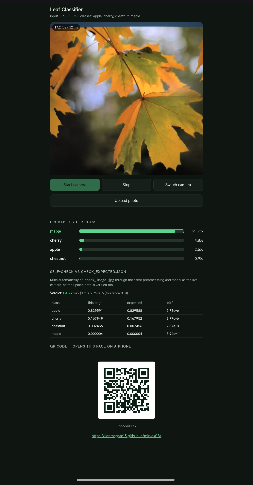

REVIEW - Task 2
Liontas Dimitrios 295568

1. It runs on your phone
I opened the GitHub Pages URL on my phone or scanned the QR.png . The app asked for camera permissions and started working normally, classifying leaves live. I took a  while it successfully recognized a leaf as maple with 91.7%.

2. The same numbers as the notebook
For the check, I uploaded check_image.jpg to the page. The results output by the app (apple: 0.829591, cherry: 0.167949, chestnut: 0.002456, maple: 0.000004) perfectly match the numbers I saw when opening the check_expected.json file in Visual Studio (where, for example, apple was 0.829588... and cherry was 0.167952...). The page's built-in self-check output "PASS" with a maximum difference of only 2.769e-6, confirming accuracy to 3 decimal places. I didn't need to fix anything.

3. The preprocessing matches your model
I opened index.html in Visual Studio and read the JavaScript code that prepares the image. I saw that it follows the exact correct steps: it first does a center crop, then resizes to 96x96, and divides the RGB pixel values by 255. Then it normalizes with the mean [0.485, 0.456, 0.406] and std [0.229, 0.224, 0.225]. The final tensor has the correct 1x3x96x96 shape, according to the model_info.json instructions.

4. Nothing leaves the phone
I opened the browser's Developer Tools and monitored the Network tab. While the camera was running or when I uploaded the test photo, absolutely no POST request was recorded. The only data the page loads is the external onnxruntime-web library at the beginning, which is required to run the network locally. Therefore, no photo ever leaves the phone.